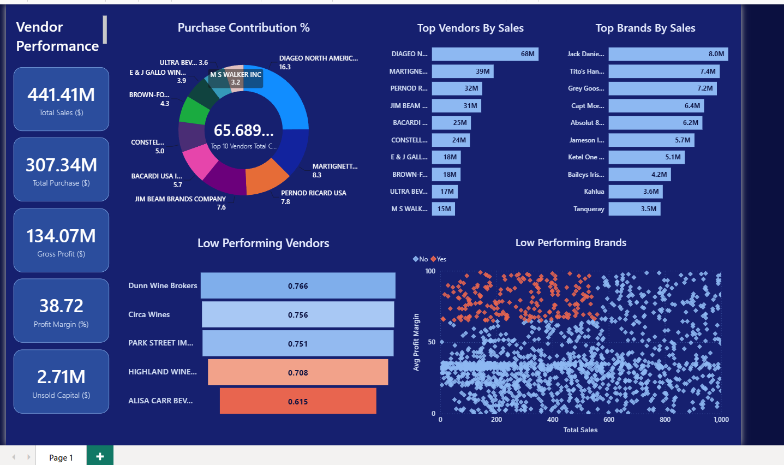

# Vendor-Performance-Analysis
Vendor Performance Analysis using SQL, Python, and Power BI to evaluate vendor profitability, purchasing trends, and inventory turnover. Applied data cleaning, EDA, and hypothesis testing to identify vendor concentration risks and unsold inventory, supporting data-driven procurement and inventory optimization.





## 🎯 Business Problem

Retail and wholesale profitability depends on buying from the right vendors, at the right price, in the right quantities. This project answers:

1. Which brands need promotional or pricing adjustments?
2. Which vendors drive sales and gross profit, and how concentrated is purchasing?
3. Does buying in bulk actually reduce unit cost?
4. Which vendors leave stock unsold, and how much capital does that tie up?
5. Do profit margins differ between high-selling and low-selling records, and is the difference statistically significant?

## ⚡ Headline Results

| $441M | 30.4% | 65.7% | $2.7M |
|:---:|:---:|:---:|:---:|
| total sales on $307M of purchases | overall gross margin ($134M gross profit) | of purchase dollars come from just 10 of 119 vendors | net capital tied up in unsold stock ($9.6M gross overstock) |

> **💡 Key insight:** The business is **concentrated and thin-margined where it matters most**. The three biggest-buying vendors with the weakest margins (Diageo, Pernod Ricard, Jim Beam at 25-26% vs a 30.4% average) also hold the most unsold stock, and the apparent "bulk discount" is really a product-mix effect, so **negotiating genuine volume pricing is the largest untapped lever**.

## 🗄️ Data Pipeline (SQL + Python)

[`get_vendor_summary.py`](get_vendor_summary.py) builds the analysis table `vendor_sales_summary` from four raw tables:

| Stage | What it does |
|---|---|
| `FreightSummary` CTE | Total freight cost per vendor from `vendor_invoice` |
| `PurchaseSummary` CTE | Joins `purchases` to `purchase_prices` (price > 0), sums quantity and dollars per vendor-brand |
| `SalesSummary` CTE | Sums sales quantity, dollars, price and excise tax per vendor-brand |
| `LEFT JOIN`s | Keeps every purchased brand even if it never sold, so unsold stock stays visible |
| Python cleaning | Type casts, null handling, text trimming, then adds `GrossProfit`, `ProfitMargin`, `StockTurnover`, `SalesToPurchaseRatio` |

**Data filtering:** 10,692 raw records were reduced to **8,565** by removing loss-making records (gross profit ≤ 0), undefined margins, and brands with zero sales.

## 📊 Key Findings

### 1. Purchasing depends heavily on a few vendors
The top 10 vendors supply **65.7%** of purchase dollars (Diageo alone 16.3%; top 3 = 32.4%). The top 10 *brands* are only 13% of sales, so the dependency risk is at vendor level.


### 2. The biggest vendors are not the most profitable


Weighted by sales, the top 10 vendors earn **29.8%** versus **31.4%** for all others. Diageo (26.3%), Pernod Ricard (25.6%) and Jim Beam (25.2%) sit 4-5 points below the portfolio average.

### 3. The bulk-purchase "discount" is a product-mix effect
Large orders pay 72% less per unit ($10.78 vs $39.06), but measured against each brand's **list price**, unit cost is about **66% in every size band**, and within the same brand order size and price are essentially uncorrelated. Large orders are simply concentrated in cheaper products.


> **So there is no real volume discount in this data, which makes negotiating one a clear opportunity** (large-order records generate about 91% of sales).

### 4. Low-sales, high-margin brands are real but small
198 brands combine bottom-15% sales with top-15% margins (average margin **79.8%**), yet together they sold only **$55.9K (0.01% of sales)**. Pilot promotions on a few before scaling.


### 5. Capital trapped in unsold stock
Net unsold capital is **$2.71M**, which nets **$9.55M of overstock** (4,229 records) against $6.85M of records that sold more than they bought. Diageo ($722K), Jim Beam ($555K), Pernod Ricard ($471K) and William Grant ($402K) lead.


### 6. Margins differ significantly, but small records barely matter


| Group | Avg margin | 95% CI | Sales-weighted margin |
|---|---|---|---|
| Top 25% by sales | 31.2% | 30.7% to 31.6% | 29.5% |
| Bottom 25% by sales | 41.5% | 40.5% to 42.6% | 44.7% |

Welch's t-test: t = -17.6, **p < 0.001** (Mann-Whitney agrees), so mean margins differ. But the bottom 25% hold only **0.25% of sales**, while the top 25% deliver **88.1% of sales and 85.7% of gross profit**, so pricing and cost control on large records matter most.

## 🛠️ Analyst Toolkit Demonstrated

| Skill | Where it was used |
|---|---|
| SQL | CTEs, multi-table joins, LEFT JOINs and aggregation to build the vendor summary |
| Pandas | Cleaning, `groupby` / `agg`, `qcut` bucketing, quantile thresholds, Pareto analysis |
| Statistics | Confidence intervals, Welch's t-test, Mann-Whitney test, correlation analysis |
| Analytical rigor | Checked the bulk-discount claim against list price, separated net vs gross overstock, used sales-weighted margins |
| Visualization | Seaborn / Matplotlib charts and a Power BI dashboard |

## 📊 Power BI Dashboard

One-page interactive report (12 visuals) built on the cleaned summary plus three helper tables (brand performance, purchase contribution, low-turnover vendors):

- **6 KPI cards:** purchases, sales, gross profit, margin, unsold capital, purchase contribution
- **Donut and bar charts:** purchase contribution by vendor, top vendors and top brands by sales
- **Funnel and scatter:** low-turnover vendors and low-sales / high-margin brands

<!-- Add a screenshot: save it as images/dashboard.png, then uncomment the next line -->
<!-- <p align="center"></p> -->

## ✅ Recommendations

| # | Action | Evidence |
|---|---|---|
| 1 | **Negotiate real volume discounts** tied to order size | Cost ≈ 66% of list price at every order size; large orders = 90.8% of sales |
| 2 | **Reduce vendor dependency;** renegotiate with Diageo, Pernod Ricard, Jim Beam | Top 10 = 65.7% of purchases; those three earn 25-26% margins |
| 3 | **Clear slow stock** with smaller reorders and clearance | $2.71M net ($9.55M gross) unsold |
| 4 | **Pilot promotions** on a few of the 198 high-margin, low-sales brands | 79.8% margin but only $55.9K total sales |
| 5 | **Protect margin on the top-sales quartile** | 88.1% of sales and 85.7% of gross profit |

## 🔍 Limitations

- Loss-making and unsold records (19.9% of the raw table) were excluded, so profit figures describe profitable records only.
- Gross profit is sales minus purchases in the period (a cash view), not cost of goods sold.
- Freight is a vendor-level total, not allocated to brands, and the data has no dates, so trends over time are not studied.

## 🚀 Next Steps

- [ ] Analyze the excluded records separately to quantify losses and dead stock
- [ ] Allocate freight to brands and add a sales-weighted margin measure (DAX) to the dashboard
- [ ] Add monthly data to study turnover and seasonality

## 📁 Repository Structure

```
Vendor-Performance-Analysis/
├── README.md
├── get_vendor_summary.py                 # SQL pipeline: builds vendor_sales_summary
├── Vendor_Performance_Analysis.ipynb     # cleaning, EDA, analysis, statistics
├── vendor_performance.pbix               # Power BI dashboard
├── images/                               # charts used in this README
└── report/
    └── Vendor_Performance_Analysis_Report.pdf
```

## ▶️ How to Reproduce

```bash
pip install pandas numpy seaborn matplotlib scipy jupyter
python get_vendor_summary.py          # builds vendor_sales_summary inside inventory.db
jupyter notebook Vendor_Performance_Analysis.ipynb
```
Place `inventory.db` (or `vendor_sales_summary.csv`) next to the notebook and run all cells. The last cell exports the helper tables used by the Power BI file.

## 👤 About Me

**Vicky Jeeru**: Data Analyst & Power BI Developer, Hyderabad, India

[](https://www.linkedin.com/in/vicky-jeeru-257a18281/)
[](https://vickyjeeru.my.canva.site/)
[](mailto:jeeruvicky51@gmail.com)

*Open to Data Analyst and BI roles. If this project was useful, a ⭐ is appreciated.*
